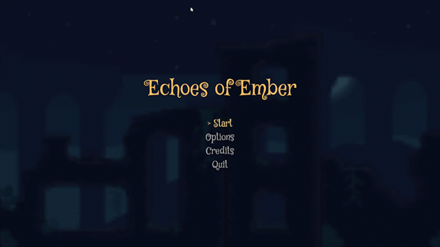

# Echoes of Ember
A pixel art platformer where you guide a tiny flame through frozen, leaking ruins to reach the lantern.

> **archived.** this is the final pygame version. development moved to Godot, which lives on `main`. this branch is also tagged `pygame-final`.




## What is it
ember is a little flame carrying her own fire. the ruins he's walking through are cold, and wet, and trying to put her out. get across the platforms, dodge the frost and the dripping ceilings, reach the lantern.

i started this in pygame because i wanted to understand how a platformer actually works under a game engine (physics, camera, scenes, all of it), so most of the engine stuff here is done with pygame-ce

## Quick start
```bash
git clone -b pygame https://github.com/armansinghh/echoes-of-ember.git
cd echoes-of-ember
pip install -r requirements.txt
python main.py
```
needs Python >=3.10. the game starts fullscreen, use **Pause (Esc) > Quit** to exit.

> `requirements.txt` installs **pygame-ce**. don't install classic `pygame` in the same env

## Controls
| Action | Keys |
| --- | --- |
| Move | A / D or Left / Right |
| Jump | Space or W |
| Pause | Esc |
| Menus | Up / Down (or W / S), Enter |
| Level select | Left / Right (or A / D), Enter or Space to play |

## Features
- momentum-based movement with acceleration and friction, so ember slides a bit instead of stopping dead
- parallax backgrounds that scroll at different speeds and tile endlessly
- levels defined in JSON (platforms, ceilings, voids, hazards, lantern position)
- three hazards: frost patches, moth (full implementation in godot), and water droplets that form on leaking ceiling tiles, fall, and splash
- menu, level select, pause (blurred game behind it), and fade transitions between scenes
- tile variants get randomized per platform, so floors don't look copy-pasted

## How it works
a few decisions worth explaining:

- **separate X/Y collision.** the player moves on X, resolves collisions, then moves on Y and resolves again. doing both at once makes corners ugly (you snag on walls or tunnel through floors). position is kept as floats and synced back to the integer rect after each axis so slow movement doesn't get rounded away.
- **virtual resolution.** everything draws to a 640x360 surface and gets scaled up to the monitor with no smoothing, which keeps the pixels crisp. scale uses `max()` so it fills the screen, cropping if the aspect ratio isn't 16:9.
- **parallax with modulo.** each layer scrolls at `camera offset × scroll factor` and wraps with `%` so the background tiles forever. layers cache their scaled surface so nothing gets rescaled every frame.
- **droplets are a tiny state machine** (start, falling, splashing, residue), triggered by a specific frame of the leak tile's animation, so the drip lines up with the art.

## Status
- only the tutorial level (`level_00`) is playable
- options and credits screens are placeholders
- the moth hazard art is drawn but not in the game yet
- no sound
- no more work here, moved to Godot :)

## QnA

### why leave pygame?
i hand-wrote a scene manager, camera, parallax, fade transitions, spritesheet slicing, and collision resolution. fun to learn, but every new level meant typing rect coordinates in JSON and rerunning the game to check them. Godot has all of that built in and a visual tilemap editor, so the time goes into actually making levels instead of maintaining an engine.

### where's the Godot version?
on `main` in this same repo.

## Credits
- font: Mystery Quest, licensed under the SIL Open Font License (see `assets/fonts/OFL.txt`)
- art: made by me in [Pixelorama](https://github.com/Orama-Interactive/Pixelorama)
- built with [pygame-ce](https://pyga.me)

## License
[MIT](LICENSE) © 2026 Arman Singh